<div align="center">

# HỆ THỐNG THU THẬP VÀ PHÂN TÍCH DỮ LIỆU CHẤT LƯỢNG KHÔNG KHÍ TỪ API VÀ CẢM BIẾN IoT GIẢ LẬP

**Real-Time Air Quality Analytics Pipeline with Redpanda, ClickHouse, Apache Airflow, and Grafana**

[](https://airflow.apache.org/)
[](https://redpanda.com/)
[](https://clickhouse.com/)
[](https://grafana.com/)
[](https://www.python.org/)
[](https://docs.docker.com/compose/)

**Trường Đại học Thủy Lợi – Phân hiệu TP. Hồ Chí Minh**  
**Học phần:** Quản lý Dữ liệu Lớn (Big Data Management) | **Lớp:** S27-66TTNT – Bộ môn Công nghệ thông tin

</div>

---

## DANH MỤC HỒ SƠ BÀI TẬP LỚN

Kho lưu trữ này bao gồm đầy đủ báo cáo học thuật, slide thuyết trình, mã nguồn triển khai, bộ dữ liệu/API đầu vào và minh chứng thực nghiệm theo yêu cầu của học phần:

| STT | Hạng mục hồ sơ | Đường dẫn truy cập trong Repository | Mô tả nội dung |
| :-: | :--- | :--- | :--- |
| **01** | **Báo cáo Bài tập lớn (.docx)** | [`docs/BAO_CAO_BAI_TAP_LON_CUOI_KY_NVPQ_LQH.docx`](./docs/BAO_CAO_BAI_TAP_LON_CUOI_KY_NVPQ_LQH.docx) | Bản báo cáo kỹ thuật đầy đủ 8 phần (kiến trúc, lược đồ dữ liệu, triển khai và thực nghiệm). |
| **02** | **Slide Trình bày (.pptx)** | [`docs/Hệ thống phân tích dữ liệu chất lượng không khí.pptx`](./docs/H%E1%BB%87%20th%E1%BB%91ng%20ph%C3%A2n%20t%C3%ADch%20d%E1%BB%AF%20li%E1%BB%87u%20ch%E1%BA%A5t%20l%C6%B0%E1%BB%A3ng%20kh%C3%B4ng%20kh%C3%AD.pptx) | Bản trình chiếu tóm tắt kiến trúc, luồng xử lý và kết quả thực nghiệm phục vụ báo cáo trước hội đồng. |
| **03** | **Mã nguồn & Hướng dẫn thực thi** | [`HUONG_DAN_CAI_DAT_VA_CHAY.md`](./HUONG_DAN_CAI_DAT_VA_CHAY.md) & [Mục 4 bên dưới](#4-hướng-dẫn-triển-khai-và-thực-thi-hệ-thống) | Tài liệu hướng dẫn chi tiết từng bước cài đặt, khởi chạy Docker Compose, nạp SQL và chạy kiểm thử. |
| **04** | **Bộ dữ liệu & Nguồn dữ liệu** | [Mục 2 – Nguồn dữ liệu và Lược đồ bản tin](#2-nguồn-dữ-liệu-thu-thập-và-lược-đồ-bản-tin) | Đường dẫn Open-Meteo REST API (CAMS Global) và mã nguồn giả lập 500 cảm biến IoT. |
| **05** | **Kết quả chạy thử & Kiểm thử** | [Mục 5 – Kết quả thực nghiệm](#5-kết-quả-vận-hành-và-minh-chứng-kiểm-thử) & [`docs/images/`](./docs/images/) | Minh chứng chạy DAG Airflow, cụm 3 Broker Redpanda, chịu lỗi khi ngắt ClickHouse và so sánh hiệu năng. |
| **06** | **Danh sách thành viên & Đóng góp** | [Mục 6 – Thành viên thực hiện và Phân công](#6-danh-sách-thành-viên-phân-công-nhiệm-vụ-và-mô-tả-đóng-góp) | Thông tin chi tiết thành viên, mã số sinh viên, nhiệm vụ đảm nhiệm và tỷ lệ đóng góp. |

---

## 1. TỔNG QUAN BÀI TOÁN VÀ KIẾN TRÚC HỆ THỐNG

Ô nhiễm không khí đô thị, đặc biệt là nồng độ bụi mịn $\text{PM}_{2.5}$ và $\text{PM}_{10}$, có biến động lớn theo không gian và thời gian ngắn. Đề tài xây dựng hệ thống thu thập, xử lý luồng và phân tích dữ liệu chất lượng không khí theo thời gian gần thực cho 5 đô thị lớn tại Việt Nam (Hà Nội, TP. Hồ Chí Minh, Đà Nẵng, Hải Phòng và Cần Thơ), đồng thời thực hiện đối sánh thực nghiệm giữa hai kiến trúc đường ống dữ liệu lớn trên Docker Compose:

- **Pipeline 2 – Kiến trúc Hiện đại (Trọng tâm triển khai):**  
  `Apache Airflow` $\rightarrow$ `Python Producer` $\rightarrow$ `Redpanda Cluster (3 Brokers)` $\rightarrow$ `ClickHouse (Kafka Engine + Materialized View + MergeTree)` $\rightarrow$ `Grafana Geomap Dashboard`.
- **Pipeline 1 – Kiến trúc Truyền thống (Đối chứng Baseline):**  
  `Apache Airflow` $\rightarrow$ `Apache Kafka (3 Brokers + ZooKeeper)` $\rightarrow$ `Spark Structured Streaming` $\rightarrow$ `Apache Cassandra` $\rightarrow$ `Streamlit`.

### 1.1. Sơ đồ kiến trúc hệ thống Pipeline 2 (Redpanda + ClickHouse + Grafana)
<div align="center">
  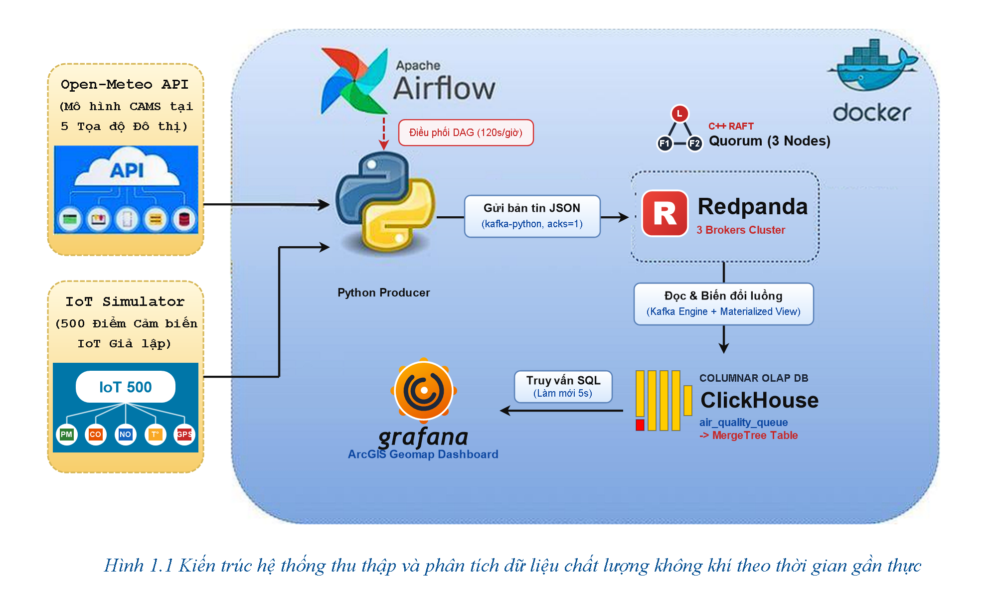
  <p><em>Hình 1.1 – Kiến trúc hệ thống thu thập và phân tích dữ liệu chất lượng không khí theo thời gian gần thực (Pipeline 2).</em></p>
</div>

### 1.2. Sơ đồ kiến trúc đối chứng Pipeline 1 (Kafka + ZooKeeper + Spark + Cassandra)
<div align="center">
  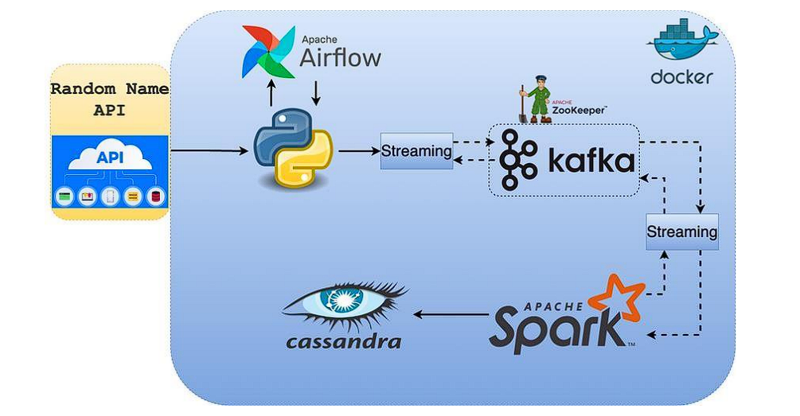
  <p><em>Hình 1.2 – Kiến trúc đường ống truyền thống phục vụ đối chứng tài nguyên và tốc độ truy vấn (Pipeline 1).</em></p>
</div>

### 1.3. Đối chiếu công nghệ giữa hai đường ống

| Tầng chức năng | Pipeline 1 (Kiến trúc Truyền thống) | Pipeline 2 (Kiến trúc Hiện đại) | Ý nghĩa cải tiến kỹ thuật |
| :--- | :--- | :--- | :--- |
| **Điều phối quy trình** | Apache Airflow 2.6 + PostgreSQL 13 | Apache Airflow 2.6 + PostgreSQL 13 | Kiểm tra sức khỏe hạ tầng đầu vào và lập lịch chạy tự động. |
| **Hàng đợi thông điệp** | Apache Kafka 7.3.2 (3 Brokers) + ZooKeeper | **Redpanda v23.3.10 (3 Brokers, C++)** | Tương thích Kafka API, đồng thuận Raft nội tại, loại bỏ JVM và ZooKeeper. |
| **Xử lý luồng dữ liệu** | Apache Spark Structured Streaming 3.5.0 | **ClickHouse Materialized View** | Biến đổi dữ liệu và phân loại ngưỡng $\text{PM}_{2.5}$ ngay khi nạp, không cần cụm Spark riêng. |
| **Lưu trữ phân tích** | Apache Cassandra 5.0 (Wide-Column) | **ClickHouse 24.3 (`MergeTree` Columnar)** | Lưu trữ hướng cột nén ZSTD, chỉ đọc đúng cột cần tính toán kèm thực thi vector hóa SIMD. |
| **Trực quan hóa** | Streamlit Web App | **Grafana OSS 10.4.1** | Bản đồ nhiệt không gian ArcGIS Geomap, biểu đồ chuỗi thời gian tự làm mới mỗi 5 giây. |

---

## 2. NGUỒN DỮ LIỆU THU THẬP VÀ LƯỢC ĐỒ BẢN TIN

Hệ thống hợp nhất dữ liệu từ **2 nguồn độc lập** và chuẩn hóa thành chuỗi JSON mã hóa UTF-8 gồm **17 thuộc tính đầu vào** (tầng ClickHouse tính toán bổ sung thuộc tính thứ 18 là nhãn cảnh báo `aqi_status`):

### 2.1. Nguồn dữ liệu 1: Open-Meteo Air Quality REST API (`REAL_OPEN_METEO_API`)
- **Điểm cuối truy vấn (REST Endpoint):** `https://air-quality-api.open-meteo.com/v1/air-quality`
- **Tài liệu kỹ thuật:** [Open-Meteo Air Quality API Documentation (CAMS Global)](https://open-meteo.com/en/docs/air-quality-api)
- **Tham số thu thập:** `current=pm10,pm2_5,carbon_monoxide,nitrogen_dioxide,sulphur_dioxide,ozone`
- **Đường dẫn truy vấn trực tiếp tại 5 đô thị lớn:**
  - [Tọa độ Hà Nội (`21.0285, 105.8542`)](https://air-quality-api.open-meteo.com/v1/air-quality?latitude=21.0285&longitude=105.8542&current=pm10,pm2_5,carbon_monoxide,nitrogen_dioxide,sulphur_dioxide,ozone)
  - [Tọa độ TP. Hồ Chí Minh (`10.8231, 106.6297`)](https://air-quality-api.open-meteo.com/v1/air-quality?latitude=10.8231&longitude=106.6297&current=pm10,pm2_5,carbon_monoxide,nitrogen_dioxide,sulphur_dioxide,ozone)
  - [Tọa độ Đà Nẵng (`16.0544, 108.2022`)](https://air-quality-api.open-meteo.com/v1/air-quality?latitude=16.0544&longitude=108.2022&current=pm10,pm2_5,carbon_monoxide,nitrogen_dioxide,sulphur_dioxide,ozone)
  - [Tọa độ Hải Phòng (`20.8449, 106.6881`)](https://air-quality-api.open-meteo.com/v1/air-quality?latitude=20.8449&longitude=106.6881&current=pm10,pm2_5,carbon_monoxide,nitrogen_dioxide,sulphur_dioxide,ozone)
  - [Tọa độ Cần Thơ (`10.0452, 105.7469`)](https://air-quality-api.open-meteo.com/v1/air-quality?latitude=10.0452&longitude=105.7469&current=pm10,pm2_5,carbon_monoxide,nitrogen_dioxide,sulphur_dioxide,ozone)
- **Tệp mã nguồn thu thập:** [`data_producers/openaq_producer.py`](./data_producers/openaq_producer.py) và [`data_producers/stream_to_redpanda.py`](./data_producers/stream_to_redpanda.py).

### 2.2. Nguồn dữ liệu 2: Bộ giả lập 500 trạm cảm biến IoT (`IOT_NATIONWIDE_SENSOR`)
- **Tệp mã nguồn phát sinh:** [`data_producers/sensor_simulator.py`](./data_producers/sensor_simulator.py) và [`data_producers/stream_to_redpanda.py`](./data_producers/stream_to_redpanda.py).
- **Cơ chế mô phỏng:** Khởi tạo 500 điểm cảm biến phân bố ngẫu nhiên trong bán kính $\pm 0.12^\circ$ quanh tâm 5 thành phố lớn. Mỗi vòng lặp `0.5 giây`, chương trình lấy mẫu 50 cảm biến để phát bản tin JSON vào cụm Redpanda (tạo tải ~100 sự kiện/giây), trong đó áp dụng xác suất 5% phát sinh đột biến ô nhiễm (`is_anomaly = true`).

### 2.3. Mẫu bản tin JSON thực tế trên Redpanda
```json
{
  "source": "IOT_NATIONWIDE_SENSOR",
  "station_id": "IOT_HCM_134",
  "station_name": "Tram cam bien TP. Ho Chi Minh #134",
  "city": "TP. Ho Chi Minh",
  "latitude": 10.814521,
  "longitude": 106.671204,
  "timestamp": "2026-10-29 11:17:26",
  "pm25": 245.82,
  "pm10": 318.45,
  "co": 2410.5,
  "no2": 42.1,
  "so2": 19.8,
  "ozone": 61.3,
  "temperature": 33.4,
  "humidity": 68.2,
  "traffic_density": "CONGESTION",
  "is_anomaly": true
}
```

---

## 3. CẤU TRÚC THƯ MỤC DỰ ÁN

```text
bigdata-air-quality-pipeline/
├── README.md                                  # Tài liệu tổng quan, kiến trúc, hướng dẫn và kết quả thực nghiệm
├── HUONG_DAN_CAI_DAT_VA_CHAY.md               # Tài liệu hướng dẫn chi tiết cài đặt, thực thi và kiểm thử từng bước
├── requirements.txt                           # Danh sách các gói thư viện Python cần thiết
├── docker-compose-pipeline2.yml               # Cấu hình Docker Compose Pipeline 2 (Airflow, 3 Redpanda, ClickHouse, Grafana)
├── docker-compose-pipeline1.yml               # Cấu hình Docker Compose Pipeline 1 (ZooKeeper, 3 Kafka, Kafka UI, Cassandra)
├── docker-compose-pipeline1-airflow.yml       # Cấu hình Docker Compose dịch vụ Airflow cho Pipeline 1
├── docs/                                      # Hồ sơ báo cáo, Slide trình bày, đề bài và minh chứng thực nghiệm
│   ├── BAO_CAO_BAI_TAP_LON_CUOI_KY_NVPQ_LQH.docx
│   ├── Hệ thống phân tích dữ liệu chất lượng không khí.pptx
│   ├── DE_BAI_TAP_LON_CUOI_KY.pdf
│   ├── architecture_pipeline2.png
│   ├── architecture_pipeline1.png
│   └── images/                                # Tập hợp 15 ảnh chụp màn hình vận hành và kiểm thử hệ thống
├── data_producers/                            # Chương trình thu thập dữ liệu đa nguồn (Python Producer)
│   ├── openaq_producer.py                     # Module gọi Open-Meteo REST API tại 5 thành phố
│   ├── sensor_simulator.py                    # Module giả lập 500 trạm cảm biến IoT toàn quốc
│   └── stream_to_redpanda.py                  # Chương trình hợp nhất 2 nguồn và đẩy luồng vào cụm Redpanda
├── pipeline2_modern/                          # Cấu hình cơ sở dữ liệu ClickHouse và Dashboard Grafana
│   ├── clickhouse_init.sql                    # Khởi tạo bảng Kafka Engine, MergeTree và Materialized View
│   └── grafana/                               # Cấu hình tự động (Provisioning) Datasource & Dashboard Geomap
├── pipeline1_baseline/                        # Mã nguồn đường ống đối chứng Pipeline 1 và DAG Airflow
│   ├── dags/
│   │   ├── p2_redpanda_dag.py                 # Đồ thị DAG điều phối 4 tác vụ tuần tự của Pipeline 2
│   │   └── air_quality_dag.py                 # Đồ thị DAG điều phối của Pipeline 1
│   ├── cassandra_init.sql                     # Khởi tạo Keyspace smart_city và bảng dữ liệu trên Cassandra
│   ├── producer_to_kafka.py                   # Chương trình gửi dữ liệu vào cụm 3 Kafka Brokers
│   ├── spark_streaming_processor.py           # Ứng dụng Spark Structured Streaming xử lý luồng ghi Cassandra
│   └── app_streamlit.py                       # Giao diện Streamlit hiển thị số liệu từ Cassandra
└── benchmark/                                 # Kịch bản kiểm thử chất lượng dữ liệu và chịu lỗi
    └── test_data_faults.py                    # Kiểm thử 4 kịch bản dữ liệu lỗi, khuyết thiếu và trùng lặp (TC-B1..TC-B4)
```

---

## 4. HƯỚNG DẪN TRIỂN KHAI VÀ THỰC THI HỆ THỐNG

### 4.1. Yêu cầu môi trường
- **Hệ điều hành:** Windows 10/11 (kèm WSL2) hoặc Linux.
- **Hạ tầng Container:** Docker Engine (v24+) và Docker Compose (v2+).
- **Môi trường Python:** Python 3.8+ cùng hai thư viện `kafka-python` và `requests`:
  ```bash
  pip install kafka-python requests
  ```

### 4.2. Khởi chạy Pipeline 2 (Redpanda + ClickHouse + Airflow + Grafana)

**Bước 1 – Khởi động cụm 9 container của Pipeline 2:**
```bash
docker compose -f docker-compose-pipeline2.yml up -d
```

**Bước 2 – Khởi tạo bảng hàng đợi Kafka Engine, bảng đích MergeTree và Materialized View trên ClickHouse:**
```bash
docker exec -i clickhouse-server clickhouse-client --multiquery < pipeline2_modern/clickhouse_init.sql
```

**Bước 3 – Thu thập và phát luồng dữ liệu (chọn 1 trong 2 cách):**
- **Điều phối tự động qua Apache Airflow:** Truy cập `http://localhost:8089` (Tài khoản: `airflow` / `airflow`), bật công tắc DAG `p2_modern_redpanda_clickhouse_dag` và nhấn **Trigger DAG**.
- **Chạy trực tiếp từ cửa sổ dòng lệnh:**
  ```bash
  python3 data_producers/stream_to_redpanda.py
  ```

**Bước 4 – Truy cập các cổng giao diện giám sát:**
| Dịch vụ | Địa chỉ truy cập | Thông tin đăng nhập | Chức năng chính |
| :--- | :--- | :--- | :--- |
| **Grafana Dashboard** | `http://localhost:3000` | `admin` / `admin` | Bản đồ nhiệt ArcGIS Geomap và biểu đồ thời gian thực (làm mới 5 giây). |
| **Redpanda Console** | `http://localhost:8088` | Không yêu cầu | Giám sát cụm 3 Broker (`redpanda-1..3`), phân vùng và nội dung bản tin JSON. |
| **Apache Airflow UI** | `http://localhost:8089` | `airflow` / `airflow` | Quản lý lịch chạy, theo dõi trạng thái 4 tác vụ và nhật ký thực thi DAG. |
| **ClickHouse HTTP** | `http://localhost:8123` | `default` (trống) | Giao diện truy vấn HTTP trực tiếp của cơ sở dữ liệu phân tích cột ClickHouse. |

**Bước 5 – Thực thi kịch bản kiểm thử dữ liệu lỗi, khuyết thiếu và trùng lặp (`TC-B1` .. `TC-B4`):**
```bash
python3 benchmark/test_data_faults.py
```

---

## 5. KẾT QUẢ VẬN HÀNH VÀ MINH CHỨNG KIỂM THỬ

### 5.1. Điều phối quy trình tự động trên Apache Airflow và quản trị cụm 3 Broker Redpanda
Đồ thị DAG `p2_modern_redpanda_clickhouse_dag` thực thi tuần tự 4 tác vụ: kiểm tra cụm 3 nút Redpanda $\rightarrow$ kiểm tra kết nối Open-Meteo API $\rightarrow$ kiểm tra tiến trình ClickHouse $\rightarrow$ kích hoạt phiên thu thập dữ liệu 120 giây.

<div align="center">
  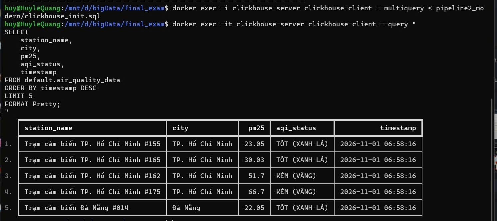
  <p><em>Hình 5.1 – Đồ thị DAG Pipeline 2 hoàn tất cả 4 tác vụ trên giao diện Apache Airflow.</em></p>
</div>

<div align="center">
  
  <p><em>Hình 5.2 – Trạng thái cụm 3 nút Redpanda hoạt động trực tuyến (3 of 3 Brokers Online) trên Redpanda Console.</em></p>
</div>

<div align="center">
  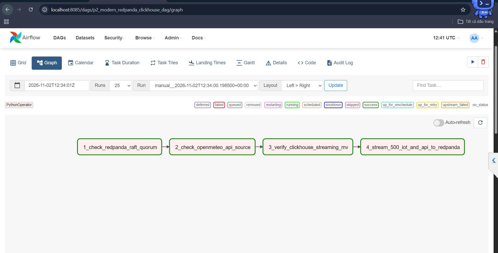
  <p><em>Hình 5.3 – Chi tiết bản tin JSON 17 thuộc tính được ghi nhận trong chủ đề air_quality_stream.</em></p>
</div>

### 5.2. Trực quan hóa dữ liệu thời gian thực trên Grafana Dashboard
<div align="center">
  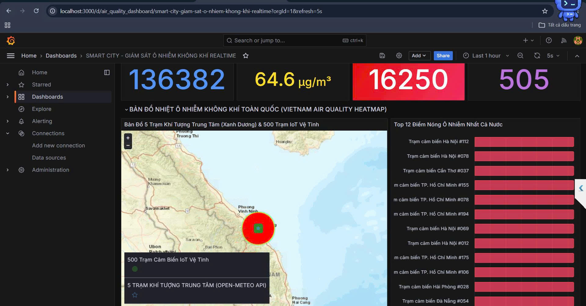
  <p><em>Hình 5.4 – Giao diện Dashboard giám sát chất lượng không khí thời gian thực với bản đồ nhiệt ArcGIS Geomap trên Grafana.</em></p>
</div>

### 5.3. Kiểm thử khả năng chịu lỗi khi ngắt cơ sở dữ liệu ClickHouse đang trong phiên truyền tải
Khi chủ động dừng container `clickhouse-server` lúc Producer đang phát luồng sự kiện:
1. **Tầng Producer không bị gián đoạn:** Nhờ kiến trúc tách biệt qua hàng đợi thông điệp, Producer vẫn hoàn tất gửi 5.760 sự kiện vào cụm Redpanda.
2. **Tầng Redpanda lưu đệm an toàn:** Cụm 3 nút Redpanda bảo toàn 8.593 bản tin (`10,9 MiB`) trên đĩa chờ ClickHouse khởi động lại để tiêu thụ tiếp từ offset đã lưu.
3. **Tầng Airflow cảnh báo chính xác:** Tác vụ `3_verify_clickhouse_olap_ready` tự động thử lại đủ 3 lần (`Tries = 3`), chuyển sang trạng thái `failed` và khóa tác vụ `4_stream_data_to_redpanda` ở trạng thái `upstream_failed`.

<div align="center">
  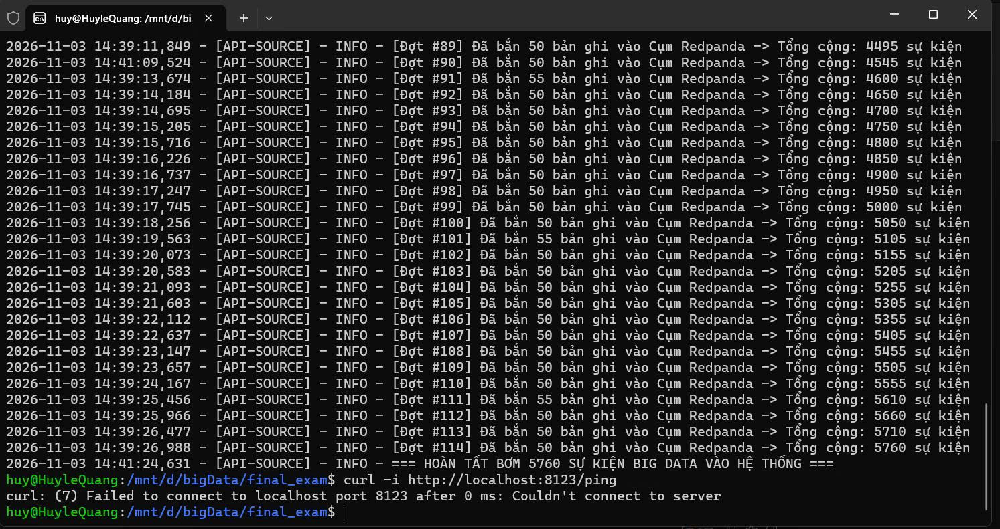
  <p><em>Hình 5.5 – Thực nghiệm dừng container clickhouse-server khi Producer đang truyền tải 5.760 sự kiện.</em></p>
</div>

<div align="center">
  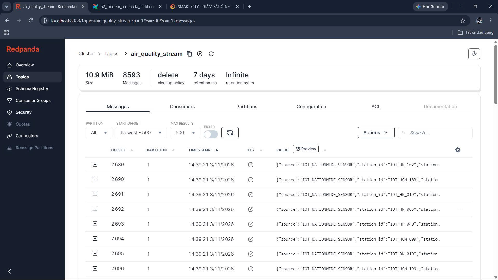
  <p><em>Hình 5.6 – Redpanda đóng vai trò bộ đệm bền vững, lưu giữ 8.593 bản tin (10,9 MiB) trong thời gian ClickHouse dừng.</em></p>
</div>

<div align="center">
  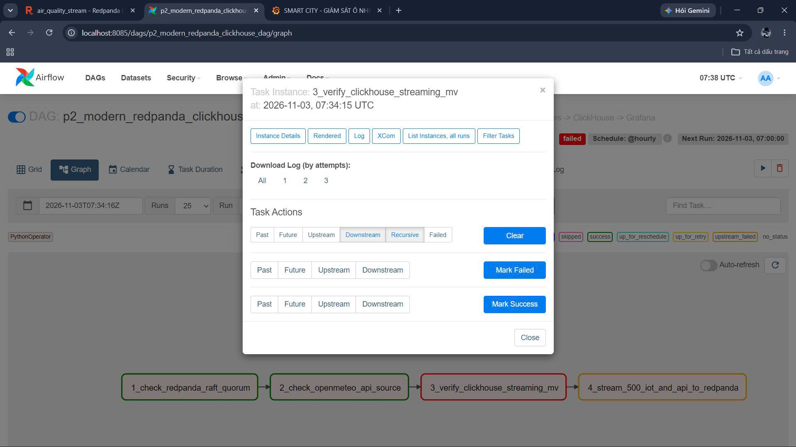
  <p><em>Hình 5.7 – Airflow tự động thử lại 3 lần, báo lỗi tại Tác vụ 3 và chặn Tác vụ 4 (upstream_failed).</em></p>
</div>

### 5.4. Kiểm thử xử lý dữ liệu lỗi cú pháp, khuyết thiếu và trùng lặp (`TC-B1` .. `TC-B4`)
Kịch bản [`benchmark/test_data_faults.py`](./benchmark/test_data_faults.py) phát trực tiếp 4 nhóm bản tin bất thường vào chủ đề `air_quality_stream`. Kết quả đối chiếu trên bảng đích `default.air_quality_data` của ClickHouse:
- **`TC-B1` (JSON hỏng cú pháp):** Bị loại bỏ tự động nhờ `kafka_skip_broken_messages = 100` (`records = 0`), không làm dừng luồng đọc.
- **`TC-B2` (Trường `pm25 = null`):** Được chuẩn hóa về `0` qua `ifNull(pm25, 0)` và gán nhãn `GOOD (Tốt)`.
- **`TC-B3` (Giá trị âm `pm25 = -25.0`):** Được ghi nhận và phân loại vào nhánh `<= 25.0`.
- **`TC-B4` (Bản tin gửi trùng 2 lần):** Ghi nhận `records = 2` trên `MergeTree()` chuẩn; tầng hiển thị Grafana khử trùng lặp bằng hàm `argMax(pm25, timestamp)` theo từng `station_id`.

<div align="center">
  
  <p><em>Hình 5.8 – Kết quả truy vấn bảng đích ClickHouse kiểm chứng 4 kịch bản TC-B1, TC-B2, TC-B3 và TC-B4.</em></p>
</div>

### 5.5. Thực nghiệm so sánh mức tiêu thụ RAM và tốc độ truy vấn phân tích (Pipeline 2 vs. Pipeline 1)

| Chỉ số đo lường thực nghiệm | Pipeline 1 (Kafka + Spark + Cassandra) | Pipeline 2 (Redpanda + ClickHouse + Grafana) | Nhận xét kết quả đối sánh |
| :--- | :---: | :---: | :--- |
| **Tổng bộ nhớ RAM tiêu thụ (`docker stats`)** | `~2.482,66 MiB` (`~2,48 GiB`) | **`~1.034,90 MiB` (`~1,03 GiB`)** | Pipeline 2 tiết kiệm **hơn 58% dung lượng RAM** nhờ loại bỏ JVM của Kafka/ZooKeeper/Spark. |
| **Thời gian truy vấn gom nhóm (`GROUP BY`)** | `180.087 µs` (`~0,180 giây` / `1.447 dòng`) | **`0,009 giây` (`9 ms` / `135.570 dòng`)** | ClickHouse xử lý nhanh hơn **20 lần** dù tập dữ liệu lớn hơn **93 lần** nhờ lưu trữ hướng cột và SIMD. |

<div align="center">
  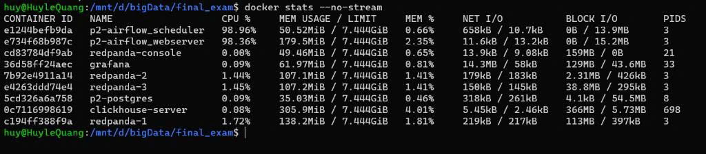
  <p><em>Hình 5.9 – Thống kê mức tiêu thụ tài nguyên (docker stats) của toàn cụm 9 container thuộc Pipeline 2 (~1,03 GiB RAM).</em></p>
</div>

<div align="center">
  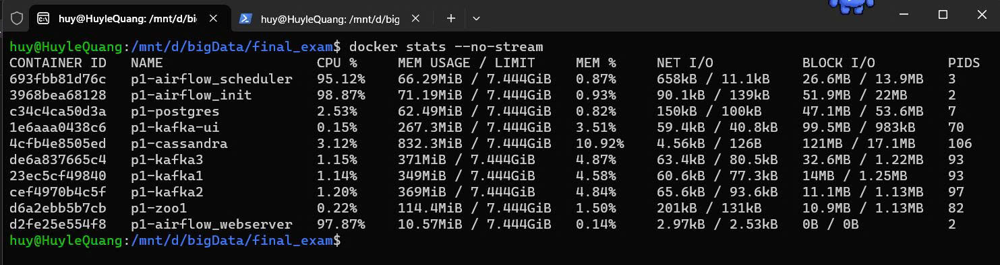
  <p><em>Hình 5.10 – Thống kê mức tiêu thụ tài nguyên (docker stats) của cụm dịch vụ thuộc Pipeline 1 (~2,48 GiB RAM, chưa tính Spark).</em></p>
</div>

<div align="center">
  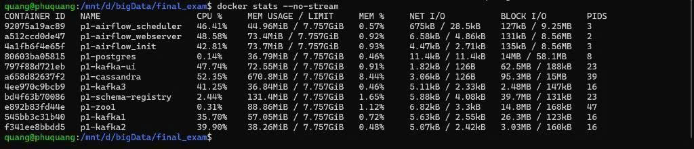
  <p><em>Hình 5.11 – Truy vấn gom nhóm tính PM2.5 trung bình trên 135.570 bản ghi của ClickHouse hoàn tất trong 0,009 giây (9 ms).</em></p>
</div>

<div align="center">
  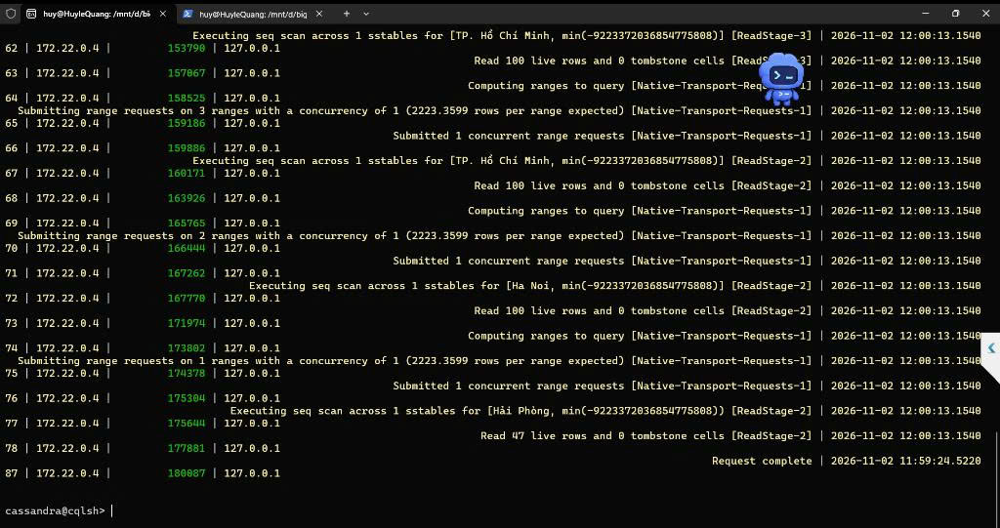
  <p><em>Hình 5.12 – Nhật ký Tracing trên Cassandra ghi nhận quá trình quét tuần tự SSTables mất 180.087 µs (~180 ms) trên 1.447 bản ghi.</em></p>
</div>

---

## 6. DANH SÁCH THÀNH VIÊN, PHÂN CÔNG NHIỆM VỤ VÀ MÔ TẢ ĐÓNG GÓP

Đồ án do nhóm 2 sinh viên lớp **S27-66TTNT** phối hợp thực hiện với phân công nhiệm vụ cụ thể như sau:

| STT | Họ và tên sinh viên | Mã số sinh viên | Hạng mục công việc đảm nhiệm | Tỷ lệ đóng góp |
| :-: | :--- | :---: | :--- | :---: |
| **01** | **Nguyễn Văn Phú Quang** | `2451267575` | Thiết kế kiến trúc cụm 3 nút Redpanda, xử lý luồng trực tuyến và lưu trữ hướng cột trên ClickHouse (`Kafka Engine`, `Materialized View`, `MergeTree`), trực quan hóa Dashboard Grafana, đóng gói Docker Compose, thực hiện kiểm thử chịu lỗi và biên soạn báo cáo. | **50%** |
| **02** | **Lê Quang Huy** | `2451267572` | Xây dựng chương trình thu thập dữ liệu Python Producer, kết nối và tích hợp 2 nguồn API (Open-Meteo Air Quality REST API và bộ giả lập 500 trạm cảm biến IoT toàn quốc), thiết kế đồ thị DAG và lập lịch điều phối tự động trên Apache Airflow. | **50%** |

---

<div align="center">
  <sub>Bài tập lớn Cuối kỳ Học phần Quản lý Dữ liệu Lớn (Big Data Management) – Trường Đại học Thủy Lợi (2026)</sub>
</div>
